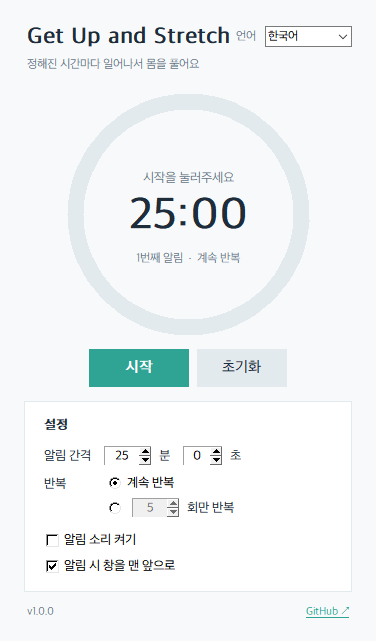

# Get Up and Stretch

[한국어](#한국어) | [English](#english)



---

## 한국어

정해진 시간마다 알림을 띄워서 일어나 스트레칭하도록 도와주는 Windows 타이머입니다.
알람을 끄려면 화면에 나온 **신기한 사실 문장을 직접 입력**해야 해서, 습관적으로 꺼버리기 어렵습니다.

### 주요 기능
- 분·초 단위로 알림 간격 설정
- 계속 반복 또는 원하는 횟수만 반복
- 남은 시간을 원이 채워지는 모습으로 표시
- 알람 해제: 랜덤으로 나오는 신기한 사실 문장을 그대로 타이핑 (붙여넣기 불가)
- 알림 소리 켜기/끄기 (기본: 끔), 알림 창 맨 앞으로 띄우기 (기본: 켬)
- 한국어 / English 전환
- 창을 닫으면 시스템 트레이로 숨겨지고 타이머는 계속 동작
  - 완전히 종료: 트레이 아이콘 우클릭 → **완전히 종료**

### 다운로드
[Releases](../../releases/latest)에서 `GetUpAndStretch.exe`를 받아 실행하면 됩니다. 설치는 필요 없습니다.

> 서명되지 않은 프로그램이라 처음 실행할 때 Windows SmartScreen 경고가 뜰 수 있습니다.
> **추가 정보 → 실행**을 누르면 됩니다.

설정은 `%APPDATA%\GetUpAndStretch\settings.json`에 저장됩니다.

### 직접 빌드하기
Python 3.10 이상이 필요합니다.

```powershell
python -m venv .venv
.venv\Scripts\pip install -r requirements.txt
.venv\Scripts\python build.py     # → dist\GetUpAndStretch.exe
```

---

## English

A Windows timer that reminds you to get up and stretch at regular intervals.
To dismiss an alarm you have to **type out a fun fact** shown on screen, so you can't just click it away.

### Features
- Set the interval in minutes and seconds
- Repeat forever, or a set number of times
- Remaining time shown as a filling ring
- Dismiss alarms by typing a random fun fact exactly (pasting is blocked)
- Optional alarm sound (off by default); bring the alarm window to front (on by default)
- Korean / English UI
- Closing the window hides it to the system tray and the timer keeps running
  - To quit completely: right-click the tray icon → **Quit completely**

### Download
Grab `GetUpAndStretch.exe` from [Releases](../../releases/latest) and run it. No installation needed.

> The executable is unsigned, so Windows SmartScreen may warn you on first launch.
> Click **More info → Run anyway**.

Settings are stored in `%APPDATA%\GetUpAndStretch\settings.json`.

### Build from source
Requires Python 3.10+.

```powershell
python -m venv .venv
.venv\Scripts\pip install -r requirements.txt
.venv\Scripts\python build.py     # → dist\GetUpAndStretch.exe
```

---

## License
[MIT](LICENSE)
